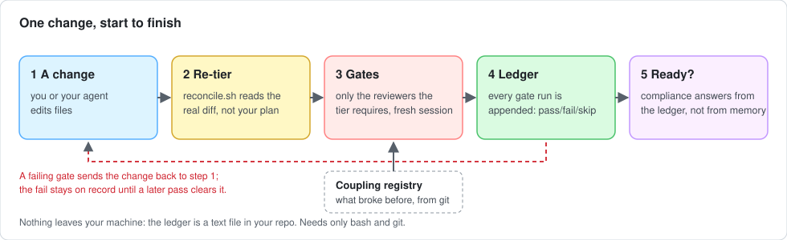
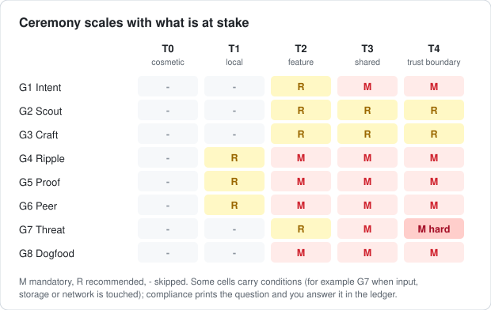
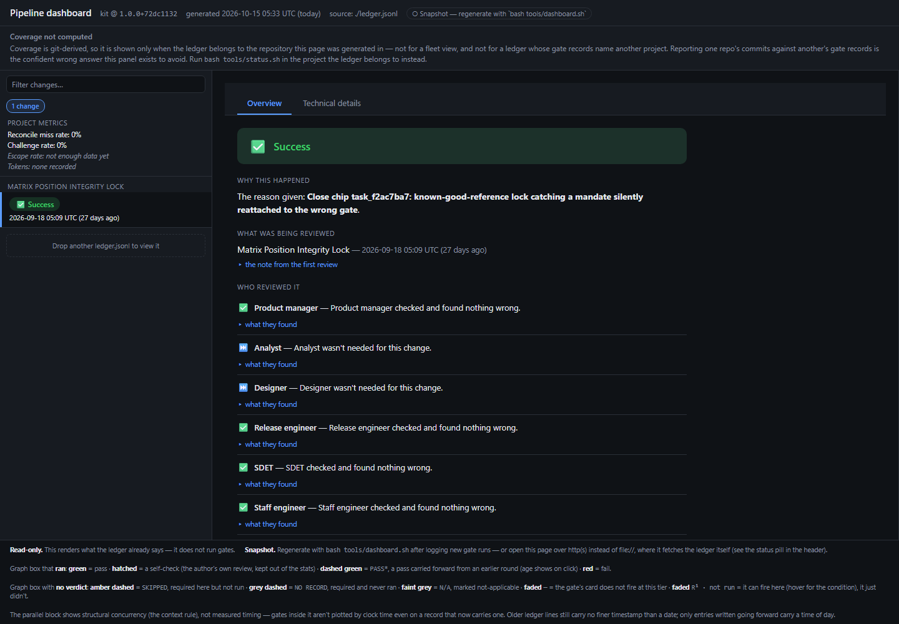
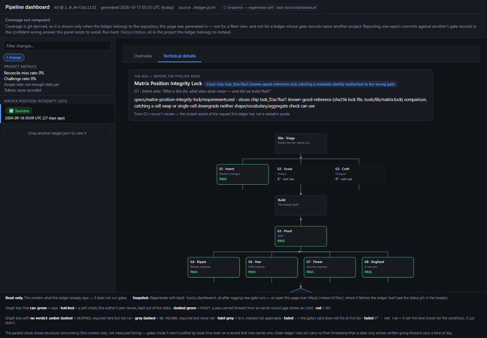

# Gated Change

[](LICENSE)


**A routed review pipeline for AI-assisted software work.**

Gates fire based on what a change *actually touches*. A coupling registry remembers what
already broke you. A ledger tells you, with numbers, whether any of it is working.

It is a folder of markdown (the method), a handful of bash scripts (the enforcement) and a
config file you fill in (your project). No server, no account, no dependencies beyond `bash`
and `git`. It works with any AI coding agent — Claude Code, Cursor, Codex, Copilot, or a
human reviewing alone.

> **New here?** Read [What problem this solves](#what-problem-this-solves), then
> [Quick start](#quick-start-30-minutes), then watch one change go through in the
> [worked example](examples/walkthrough.md). Everything else is reference.

---

## At a glance



### Who it is for

- **Solo developers and small teams shipping with an AI coding agent** (Claude Code, Cursor,
  Codex, Copilot, or a human reviewing alone) who want a safety net that does not depend on
  remembering to be careful.
- **Projects that have a few things that must not break silently**: authentication, money,
  migrations, permissions, data retention, a published artifact.
- **Anyone who wants to measure whether their review process is worth what it costs**, with
  numbers from their own repo instead of a feeling.

Not a fit if you want a scanner that finds bugs on its own, a hosted service, or a
replacement for CI. See [What it is not](#what-it-is-not).

### What you get

| Advantage | How, and what you can check |
|---|---|
| **The right review for the right change** | The risk tier is recomputed from the **real diff**, not from your plan. In this repo's ledger the real diff disagreed with the plan in 10 of 90 recorded routes, 9 of them under-classified |
| **Reviewers that do not just agree with the author** | Verify gates run in a **fresh session** that gets the diff, not your explanation. 30% of fresh runs contradicted the author |
| **A memory of what already broke you** | A **coupling registry**, mined from your own git history, is handed to the reviewer, so the same two files do not break together a third time |
| **"Ready" is a computed answer** | `compliance` reads an **append-only ledger** and refuses to call a change ready unless the mandated gates actually ran. A fail stays on record until a later pass clears it |
| **Review cost you can see** | Tokens and findings per gate, so an expensive gate can be given a cheaper model and one that has stopped finding anything can be retired |
| **Used on real projects** | Nine built with it, one of them public: [Focus Guard — Website Blocker](https://chromewebstore.google.com/detail/focus-guard-%E2%80%94-website-blo/blbbadphbklfpllimmcnhjcacdicmnge) on the Chrome Web Store. Use, not a proven effect: see [the evidence](docs/evidence.md) |
| **Nothing to host** | A folder of markdown, a few bash scripts and one config file. No server, no account, no dependencies beyond `bash` and `git`. Nothing leaves your machine |

What is **not** claimed: that it reduces defects or review effort. That is unproven, and the
[evidence page](docs/evidence.md) says exactly what the numbers can and cannot support.

### See it

**Ceremony scales with what is at stake.** A CSS tweak asks for almost nothing. A change to
authentication or a migration cannot reach release without a security review on record.



**The dashboard** is a single HTML file generated from the ledger: open it by double-click,
no server. This is a real change from this repo's own ledger: a trust-boundary (T4) change that
every mandated reviewer passed at round 1.



**The technical page** shows the same change as a graph. It starts at triage, runs the gates
the tier requires (green is a recorded pass, grey is "not required at this tier"), and each
box is backed by a line in the ledger, not by anyone's say-so.



A change that fails shows up red, and stays red until a later pass is recorded against it, so
the dashboard cannot be tidied into looking healthier than the ledger.

### Built with it, and the evidence

Nine real projects have been built with this pipeline: one public, eight private.

| Project | Visibility | Evidence |
|---|---|---|
| **Focus Guard — Website Blocker**, a Chrome extension | Public | [Published on the Chrome Web Store](https://chromewebstore.google.com/detail/focus-guard-%E2%80%94-website-blo/blbbadphbklfpllimmcnhjcacdicmnge) — you can install it and inspect it |
| Eight other projects | Private | Not linkable. Their ledgers are not in this repository |

The Web Store listing is the public evidence that the pipeline was used to ship a real
product. It is evidence of use, not of effect: it does not show how many defects were
prevented. For what the recorded review numbers can and cannot support, read
[the evidence page](docs/evidence.md).

**The gates found real problems** while this kit was being built with itself. It does not show
what would have escaped without them; read [the limits](docs/evidence.md) before quoting it.


---

## Contents

- [At a glance](#at-a-glance) — who it is for · what you get · screenshots
- [What problem this solves](#what-problem-this-solves)
- [How it works](#how-it-works)
- [Quick start (30 minutes)](#quick-start-30-minutes)
- [Core concepts](#core-concepts) — tiers · gates · the matrix · protocols · the four records
- [Using it day to day](#using-it-day-to-day)
- [Examples](#examples)
- [Command reference](#command-reference)
- [Configuration reference](#configuration-reference)
- [Enforcement: making it stick](#enforcement-making-it-stick)
- [Using it with your AI agent](#using-it-with-your-ai-agent)
- [Reading the results](#reading-the-results) — report · dashboard · status
- [Updating an installed kit](#updating-an-installed-kit)
- [Troubleshooting & FAQ](#troubleshooting--faq)
- [Repository layout](#repository-layout)
- [Status — what is and is not proven](#status--what-is-and-is-not-proven)
- [Contributing](#contributing) · [License](#license)

---

## What problem this solves

**"Why not just ask the AI to review my code?"** Review quality was never the problem.
**Routing and memory are.**

An AI reviews whatever you point it at. It will not decide, unprompted, that *this* one-line
change is the dangerous one. And it will not remember that touching the rule builder means
checking the priority space, because a bug three months ago said so. Concretely, AI-assisted
work fails in four repeatable ways:

| Failure | What happens | What the kit does about it |
|---|---|---|
| **Under-classification** | You plan a "one-line fix"; the implementation reaches into the auth module. Nobody reviews it harder, because everyone still thinks it is small | `reconcile.sh` re-derives the risk tier from the **real diff**, not from your description of it |
| **Forgotten history** | The same two files break together a third time | A **coupling registry**, mined from your own git history, is handed to the reviewer |
| **Self-review** | The model that wrote the code reviews it and agrees with itself | Verify gates run in a **fresh session** that is given the diff but *not* your explanation |
| **Unfalsifiable process** | "We do code review" — but nobody can show it ran, or that it helps | An append-only **ledger** records every gate, and `compliance` refuses to call a change ready unless the mandated gates actually *passed* |

It scales ceremony with what is at stake. A CSS tweak is a few seconds. A change to your
auth code, a database migration or a billing path cannot reach release without a security
review on record.

Who this is for is under [At a glance](#at-a-glance).

### What it is not

- **Not a linter, scanner or CI replacement.** It decides *which reviews must happen* and
  records that they did. It does not find bugs by itself — the gates (an AI or a human
  following a checklist) do.
- **Not a service.** Nothing leaves your machine. The ledger is a text file in your repo.
- **Not proven to reduce defects yet.** See [Status](#status--what-is-and-is-not-proven) —
  the repo ships a benchmark harness precisely so you can check for yourself.

---

## How it works

```
                 ┌────────────────────────────────────────────────────────┐
  your change ──▶│ ROUTER   reads the diff, matches it against            │
                 │          project/surfaces.conf  →  tier T0 … T4         │
                 └──────────────┬─────────────────────────────────────────┘
                                │ the tier decides which gates are mandatory
                                ▼
   G1 Intent · G2 Scout · G3 Craft · G4 Ripple · G5 Proof · G6 Peer · G7 Threat · G8 Dogfood
        each gate = one persona asking one question that can STOP the change
                                │
                                ▼
                 ┌────────────────────────────────────────────────────────┐
                 │ LEDGER   append-only record of what every gate did     │
                 │ COMPLIANCE   "did the gates this tier mandates PASS?"  │
                 └────────────────────────────────────────────────────────┘
                                │
                                ▼   release  →  harvest what broke into the registry
```

### The one rule of this repo

```
core/      portable. Never edit. Ships identical to every user.
project/   yours. Every project-specific fact lives here and nowhere else.
```

If you find yourself editing `core/` to fit your project, that is a bug in `core/` — the
knob you need is missing from `project/`. Open an issue rather than forking.

This split exists because the first version of this pipeline was written inside the
codebase it was designed for. Every rule came out entangled with that project's specifics —
storage keys, rule engine, browser targets — and separating them afterwards was harder than
writing them apart in the first place. It is also what lets you
[update the kit](#updating-an-installed-kit) without losing your configuration.

### Five kinds of thing

Only one of them can fail.

| Kind | What it is | Can it fail? | Count |
|---|---|:--:|:--:|
| **Router** | Decides which gates run | It can misroute | 1 |
| **Gates** | A persona asking a question that can stop the change | **Yes** | 8 |
| **Phases** | Work that always happens: Build, Package, Deploy, Record, Release | No | 5 |
| **Loops** | Fire on a trigger: *Harvest* (a rule) and *Adapt* (a gate) | No | 2 |
| **Protocols** | Rules that apply to every gate | No | 7 |

---

## Quick start (30 minutes)

**Requirements:** `bash` (3.2+) and `git`. On Windows use Git Bash or WSL. Your project must
be a git repository (the router reads `git diff`).

### 1 · Put the kit in your repo

```bash
git clone https://github.com/akshay-goel-g/gated-change.git
```

Copy it into your project as `.pipeline/`, then delete the kit's **own** development records.
A plain `cp -r` also copies the kit's ledger, security reports, `.git` and a `surfaces.conf`
describing *someone else's* project — and your first `status.sh` would then report the kit's
gate history as yours.

```bash
cp -r gated-change/ your-project/.pipeline/
cd your-project/.pipeline
rm -rf .git ledger.jsonl dashboard.html security-reports project \
       SESSION-HANDOFF.md INTENT-LOG.md LEARNINGS.md ACTION-PLAN.md dist releases tests experiments \
       specs docs .claude .github
cd ..
```

<details>
<summary>Why each of those is removed, and what to keep</summary>

- `.git` matters most: if `.pipeline` is a repository of its own, the guards that would have
  told you the install was wrong switch off.
- `ledger.jsonl`, `dashboard.html`, `security-reports/`, `project/`, `SESSION-HANDOFF.md`,
  `INTENT-LOG.md`, `LEARNINGS.md`, `specs/`, `experiments/`, `tests/`, `docs/` are the kit's own
  development artifacts, not portable content (`docs/` holds this README's images and the evidence page).
- `dist/` and `releases/` are build output from the kit's own development — dead weight in an install.
- **Keep** `CHANGELOG.md` and `VERSION`: they travel with a real install, and
  `tools/update-kit.sh` treats them as portable.
- **Keep** `LICENSE`, `NOTICE` and `examples/`. The license and notice travel with the copy, and `examples/` is
  where the ready-made `surfaces.conf` files live.
- `rsync` users: anchor every pattern with a leading slash — `--exclude '/project/'`, not
  `--exclude 'project/'`, which is unanchored and would also delete `templates/project`, the
  skeleton step 3 needs.
</details>

### 2 · Mine your coupling registry

```bash
bash .pipeline/tools/mine-registry.sh
```

Your git history already records every coupling you have: files that keep getting *fixed
together* are coupled, whether or not anyone wrote that down. The script drafts candidates
into `.pipeline/project/registry-draft.md`; you keep the ones you can explain and delete the rest.

> **No git history yet?** Then this step gives you nothing, and that is correct:
> ```
> Not enough history to mine. This is the expected result for a young repo.
> Start with the universal registry in core/03-registry.md and let yours grow
> from real incidents.
> ```
> **Do not invent couplings you have not experienced.** A registry of imagined failures is
> worse than an empty one, because it trains you to skim.

### 3 · Create `project/` and answer five questions

```bash
mkdir -p .pipeline/project && cp -r .pipeline/templates/project/. .pipeline/project/
$EDITOR .pipeline/project/surfaces.conf
```

This is the one step that needs you to think. The shipped file describes a browser
extension — **delete its rows and write your own**, or start from one of the
[ready-made examples](examples/surfaces/) for a web app, REST API, Chrome extension,
library/CLI or data pipeline.

| # | Question | Configures |
|---|---|---|
| 1 | What here, if it broke, would fail **silently**? | Trust surfaces (T4) |
| 2 | What platforms must every change work on? | Targets |
| 3 | What can a user do that they can never undo? | The T4 boundary |
| 4 | Where do secrets and credentials live? | Continuous security checks |
| 5 | What accumulates without a documented limit? | Scale ceilings |

Each answer becomes a line like `T4::(^|/)auth/::Authentication — silent when wrong`. See
the [`surfaces.conf` reference](#surfacesconf--the-file-that-does-the-work) for the format.

> **Until you do this, every tool will tell you the rules are somebody else's.** Nothing of
> yours matches the shipped example, so every change routes T0 with no gate ever mandatory.

### 4 · Wire up enforcement

```bash
bash .pipeline/tools/install-hook.sh            # git pre-push hook, derived from your T4 rows
bash .pipeline/tools/install-claude-hook.sh     # Claude Code only: re-entry reminder on every edit
mkdir -p .github && cp .pipeline/templates/PULL_REQUEST_TEMPLATE.md .github/
```

Then paste [`templates/agent-instructions.md`](templates/agent-instructions.md) into whichever
file your agent reads every session (`CLAUDE.md`, `AGENTS.md`, `.cursorrules`, …). That is the
only enforcement point that acts *before* work starts, when routing is still cheap.

`install-hook.sh` prints the rules it is guarding — **read that output**. It refuses to
install a hook that would guard nothing:

```
Installed .git/hooks/pre-push
  Guarding 2 T4 rule(s) from …/.pipeline/project/surfaces.conf:
      (^|/)auth/  → Authentication — a bug here is a silent account takeover
      (^|/)migrations?/  → Data migration — not reversible once run

  It blocks a push touching those paths unless a report in
  .pipeline/security-reports names a commit that contains every one of those changes.
```

Things the hook also does, so none of them surprises you on your first push:

- **It regenerates `dashboard.html` and commits it** (`auto: regenerate dashboard.html
  (pre-push)`) whenever the ledger has moved since the last one. Git has already decided what
  the push sends by then, so that commit rides out on the *next* push: right after a push that
  looked successful your branch is one commit ahead of the remote. Push once more to sync it.
- **Regeneration takes a while** on a slow machine (minutes, in one measured run) and prints
  nothing while it works. `--no-verify` skips both the check and the regeneration.
- **The first push of an existing project to an empty remote counts the whole history as "the
  push"**, including trust-boundary commits that predate the kit (`status.sh` leaves those out on
  purpose). Expect it to block until a report in `security-reports/` names the tip you are pushing,
  or log the exception and use `--no-verify`.
- **A force push is checked against what it ADDS, not what it throws away.** A push that does not
  contain the remote's current tip drops those commits, and a trust-boundary fix among them is not
  considered by the hook (known gap, R-009 (9)): review what a force push discards yourself. A pure
  **rollback** (`reset --hard` then `push --force`, so the push adds no commit) can never be satisfied by
  a report -- every commit a report could name is already on the remote -- and needs `--no-verify`
  plus the ledger exception line the BLOCKED message prints.
- **A pin file that gives no cutoff keeps the whole history counted.** While the kit is not committed
  yet, `status.sh` pins the install point in `.pipeline/.install-base`. If that file is empty,
  garbage, a link, or names a commit this clone does not have, it is never rewritten (a rewrite to
  HEAD would hide unrouted work); `status.sh` says so. The way out is `BASELINE=<the install
  commit>`, or deleting the file to pin again -- at the CURRENT HEAD, so work committed since the
  install then stops counting.


### 5 · Start the ledger and check it is on

```bash
touch .pipeline/ledger.jsonl
export PIPELINE_MODEL=<the model you use>      # recorded on every gate run; omit it and ledger.sh warns
bash .pipeline/tools/status.sh
```

`status.sh` is the one command that compares the ledger against **git history** — what has
landed since the last gate run, which gates have never run, and which enforcement points are
not installed. It needs no arguments and no prior knowledge of what you are working on, which
is exactly what you want when the pipeline is the thing that stopped.

### 6 · Commit it, and work on a branch

```bash
git checkout -b my-first-change                                # gates bind to a change's commits, not to trunk
git add .pipeline && git commit -m "Add gated-change"          # the kit only
```

Commit the kit **on its own, before any real work** (and commit `.github` or `.claude` afterwards with
`git add .github && git commit -m "Add CI"` -- `status.sh` will count that commit as unrouted work until a gate
is logged, which is correct: it is project work). `status.sh` counts unrouted work from the
commit that installed the kit. If that commit also carries project work, `status.sh` counts it
too (the cutoff moves to just before it), so nothing is lost -- but a kit commit of its own keeps
the numbers readable.

- **Commit `.pipeline/` and the ledger.** An uncommitted ledger blocks `git checkout` the
  moment a branch also touches it, and a ledger that is not in git is evidence nobody else can
  see. Commit it with the change it describes.
- **Reading `status.sh`:** it counts commits since the last gated commit, or since the kit was installed
  if nothing has been gated. Two branches each gated and then merged are both anchors, so nothing they
  contain is counted. `BASELINE=<ref>` counts from a commit you choose (`BASELINE=none` counts the whole
  history); a ref that names nothing is reported and ignored. If the ledger names gated commits but none is
  reachable from where you are (a squash or rebase merge, or another branch), log a gate on the commit you
  are on to anchor the count.
- **Work on a branch, not on trunk.** `ledger.sh compliance` ties each gate record to the
  commits of the change; a pass logged on another branch, or on trunk after your branch point,
  does not count toward it (one logged AT the branch point itself still does).
- **Do not union-merge `ledger.jsonl`.** When two branches both log gates, the ledger conflicts
  when you merge; keep both sides' lines in the order they were logged, then run `compliance` and
  re-log any gate whose pass came from the other branch. A union merge hides the conflict and lets
  the verdict follow merge direction. Expect the conflict on every merge of two branches that both
  logged anything (even for different changes): it is the signal, not a malfunction.
- **Follow-ups on the same change use a higher round:** `ROUND=2 bash .pipeline/tools/reconcile.sh T4 --log`
  (or `--round 2`). A round-1 reconcile with a different base (for example after a push, when you forgot
  `ROUND`) would start a **new lineage**: it re-records the base and the tier floor, and every gate result
  so far stops counting. That is refused unless you say so with `--restart-lineage` (or `RESTART_LINEAGE=1`);
  re-running the same reconcile with the same base needs nothing. `--restart-lineage` always means
  round 1: a `--round`/`ROUND` given with it is ignored, with a note.

**You are done.** The ledger stays empty until the first gate runs — which is how you will
know whether the pipeline is real.

---

## Core concepts

### Tiers — how much is at stake

The router sorts every change into one of five tiers. **When torn between two, take the
higher one** — over-classifying is free, under-classifying is the failure the whole kit exists
to catch.

| Tier | Name | Definition |
|---|---|---|
| **T0** | Cosmetic | Copy, comments, docs, non-shipping assets. Zero behaviour change |
| **T1** | Local | One module. No shared state, no new public surface, trivially revertable |
| **T2** | Feature-scoped | One feature end to end. May own new storage and UI |
| **T3** | Cross-cutting | Shared modules, persisted schema, message handlers, 2+ features |
| **T4** | Irreversible | Trust boundaries, permissions, migrations — **or anything a user cannot undo, and anything touching money** |

The rule of thumb for what is T4: **if breaking it would be *silent*, it is T4.** Visible
breakage gets reported by users. Silent breakage does not.

Routing also looks at *visibility* (does a user see a change? → Dogfood is mandatory) and
*targets* (every platform you ship on needs evidence, because "it should work the same" is a
prediction, not a test).

### Gates — eight reviewers, each with one question

| Gate | Persona | Asks | Budget |
|---|---|---|:--:|
| **G1 · Intent** | Product manager | Who is this for, what does "done" mean — and did we build that? | 15m |
| **G2 · Scout** | Analyst | How does the world solve this, and what does everyone get wrong? | 20m |
| **G3 · Craft** | Designer | Does this look and behave like the rest of the product? | 15m |
| **G4 · Ripple ★** | Release engineer | What breaks if this is wrong, and can it ship alone? | 10m |
| **G5 · Proof** | SDET | Would this bug have been caught, and will the next one be? | 30m |
| **G6 · Peer** | Staff engineer | Is this correct, simple and consistent? | 15m |
| **G7 · Threat** | Security engineer | What can a hostile input or a confused user do with this? | 20m |
| **G8 · Dogfood** | A real user | Forget the code. Use the thing. Does it work? | 15m |

Each gate lives on its own **card** in [`core/cards/`](core/cards/) — the unit you hand to a
subagent. A card states its question, what it receives, what it must **not** receive
(`withhold`), what passes it, what fails it, and the exact `ledger.sh` line that logs it.
Budgets are limits, not targets: a gate that routinely overruns is mis-scoped.

### The gate matrix — what each tier requires

`M` mandatory · `R` recommended · `—` skip

| Gate | T0 | T1 | T2 | T3 | T4 |
|---|:--:|:--:|:--:|:--:|:--:|
| G1 Intent | — | — | R | M | M |
| G2 Scout | — | — | R¹ | R¹ | R¹ |
| G3 Craft | — | — | R² | R² | R² |
| G4 Ripple | — | R | M | M | M |
| G5 Proof | — | R³ | M | M | M |
| G6 Peer | — | R | M | M | M |
| G7 Threat | — | — | R⁴ | M | **M (hard)** |
| G8 Dogfood | — | — | M⁵ | M⁵ | M |

¹ Net-new user-facing capability only; never blocks a release. ² Only when a UI surface
changes. ³ **Mandatory for any bug fix** — a fix without a regression test is not a fix.
⁴ Mandatory whenever the change accepts input, persists data or makes a network request.
⁵ Skip only when the change is invisible to users.

A footnoted `M` is a *conditional* mandate the ledger cannot evaluate on its own, so
`compliance` reports it as `UNRESOLVED` and prints the question. You answer it by running the
gate or by logging `--outcome n/a --note "<why it does not fire here>"`. `n/a` is accepted
**only** where the matrix cell carries a footnote — G7 at T4 has none, so `n/a` there is
`REFUSED`.

### The seven protocols — they catch problems in the *reviewing*

Gates catch problems in the code. Protocols catch problems in the reviewing — which is why
skipping them quietly voids the gates too.

| Protocol | The rule |
|---|---|
| **Context** | Ripple, Peer, Threat and Dogfood run in a **fresh session** that did not write the code. A model reviewing its own work defends it. If you cannot get a fresh session, the result is logged `low` confidence and excluded from statistics |
| **Blind review** | The reviewer gets the diff and the registry — **not your explanation**. Telling a reviewer "this fixes the race" makes them confirm the race is fixed and miss what you did not mention |
| **Evidence** | Every claim cites `file:line` or command output — **including agreement**. A finding without a citation is deleted. "Looks correct" with no citation is indistinguishable from not having checked |
| **Disagreement quota** | If a gate never contradicts the author across ten runs, **the gate is broken**. AI reviewers lean toward agreement; that needs a number, not an intention |
| **Failure** | Record the finding, return to the phase that caused it, re-run the failed gate, and **two consecutive failures of one gate escalate the tier by one** |
| **Probe** ([`core/10-probe.md`](core/10-probe.md)) | A self-doubt protocol at three checkpoints. It forces a *named* doubt — "nothing" is not an available answer |
| **Grounding** ([`core/12-grounding.md`](core/12-grounding.md)) | A checklist against confident, unchecked claims |

### The four records

Four files, separated by **write pattern** — mixing an append-only record into a rewritten
one loses the record.

| Record | Write pattern | Holds |
|---|---|---|
| **Handoff** `SESSION-HANDOFF.md` | Rewritten in place, **~100 line cap** | Where we are *now* |
| **Intent log** `INTENT-LOG.md` | Append-only, never edited | What was asked and why — including decisions that left **no code**, which git cannot hold |
| **Learnings** `LEARNINGS.md` | Append-only | What broke, what we now know. "Why we missed it" is the field that pays |
| **Ledger** `ledger.jsonl` | Append-only, machine-written, **never backfilled** | What the gates did |

Copy the first three from `templates/` into your docs folder:

```bash
cp .pipeline/templates/SESSION-HANDOFF.md .pipeline/templates/INTENT-LOG.md \
   .pipeline/templates/LEARNINGS.md docs/
```

### Two maps, and why you need both

The **coupling registry** (`project/registry.md`) is *behavioural*: what breaks what, mined
from things that already went wrong. The **system map** (`project/map.md`) is *structural*:
what exists at all. The registry is backward-looking, so **a component nobody has broken yet
is invisible to it** — the map covers the parts that have been quiet. Ripple maintains both,
in the diff, not on a schedule.

### What to ignore at first

Adoption fails from starting with all of it. Defer, in this order: the gate library
(`core/06-extending.md`), Adapt, promotion and retirement of gates (needs ~ten runs of data),
and the metrics (compute after a month, not a week). **Start with** the router, eight gates at
default tiers, the universal registry, the ledger and the probe protocol. That is the whole
system. If your first change feels heavy, you probably tiered it too high.

---

## Using it day to day

### The loop

```
"I want to build X"
   ├─ Triage             2 min    tier, surfaces, targets, gate list
   ├─ requirements.md    confirm
   ├─ design.md          confirm
   ├─ tasks.md           confirm
   ├─ Build
   ├─ Package + Deploy   seconds  produce the artifact, get it RUNNING
   ├─ The gates the tier requires
   ├─ reconcile.sh       seconds  did the diff match the prediction?
   ├─ ledger.sh compliance        did the gates that decide this actually pass?
   └─ Release → Harvest
```

A trivial change is five steps, most of them seconds. **Deploy comes before the gates** because
Dogfood's input is the *running* product. **Compliance comes after reconcile** because they
answer different questions:

> **`reconcile` asks** *is this the tier I predicted?*
> **`compliance` asks** *did the gates that tier mandates actually pass?*

Only the second can tell you a change is not ready. A logged `skipped` is the absence of a
verdict when nothing passed; once a gate has passed, a later `skipped` only records an exception
(for instance the pre-push override) and does not revoke that pass, while a later `fail` does
-- and a `skipped` logged after that fail does not hide it. The dashboard follows the same rule
but has no git, so it cannot mark a pass as outside the change's commits or apply the tier floor,
and it does not apply `compliance`'s recorded-reason check at T3/T4 (a change whose gates all passed
but whose current lineage has no recorded reason reads "Success" there and is refused by
`compliance`); `compliance` is the authority.

### Per-change checklist

| # | When | Command | Notes |
|---|---|---|---|
| 0 | Session start | `bash .pipeline/tools/status.sh` | Unrouted T3/T4 work? Route it before starting anything new |
| 1 | Before code | Read `core/01-router.md` → predict a tier | Then ask: *what did they not say that I assumed?* |
| 2 | Before code | `ledger.sh assume --change <n> --assumed '…' --resolution asked\|verified\|defaulted` | `defaulted` is legal but **refused by `compliance` at T3/T4** |
| 3 | Before code | Write `specs/<n>/requirements.md` → `design.md` → `tasks.md` | One file per confirmation. Never all three in one pass |
| 4 | After build | `CHANGE=<n> REASON="Bug fix" bash .pipeline/tools/reconcile.sh T2 --log` | Exit 1 = under-classified; run every gate the higher tier needs |
| 5 | After build | Run each mandated gate in a **fresh session** with its card | Hand it the diff + registry; withhold your explanation |
| 6 | Per gate | `ledger.sh add --change <n> --gate G7 --tier T4 --round 1 --outcome pass\|fail …` | One `--finding` per finding |
| 7 | Before release | `ledger.sh compliance --change <n> --tier T4 --round 1` | **Must exit 0** |
| 8 | At release | `reconcile.sh --action <name> --evidence "<citation>"` | Only for no-diff events (see below) |
| 9 | After release | `ledger.sh escape …` if a defect surfaces | Feeds the headline metric |

### Re-entry (R0c) — the rule that stops mid-session drift

The edit most likely to skip review is the **second** one: a gate turns up a defect, you fix
it, and the fix never passes through routing because it feels like finishing the current step
rather than a change. It is reactive, unplanned, and disproportionately likely to touch exactly
the surface the gate was inspecting.

**The rule:** any edit to a **T3 or T4** file made after routing has run re-enters at
reconcile, at a new `--round`. It reads the working tree, so a surface you did not notice
touching shows up anyway. On Claude Code, `install-claude-hook.sh` makes the edit itself print
the reminder.

### Declared events (R0d) — irreversible things that change no file

A diff-based router cannot see the most irreversible events in a release: pressing Publish,
ramping a staged rollout, rotating a signing key, flipping production traffic. None of them
change a file. Declare them as `ACTION` rows in `surfaces.conf` and fire them when they happen:

```bash
bash .pipeline/tools/reconcile.sh --action prod-deploy --evidence "https://ci.example.com/run/4821" --log
```

**This is a declaration, not a sensor** — nothing detects the event, and nothing forces you to
declare it. Evidence is checked for presence, not content.

Each firing is its own event: once a change has fired a declared action, every later firing on it (the same
action or another) is recorded as round 1 (`ROUND=` is ignored) and starts its own lineage: gates logged for the previous firing no longer count for
this one, so run and log the mandated gates again (a second deploy of unreviewed code must not inherit the
first one's passes). Order matters for a repeat: fire first, then run and log the gates; gates logged before
the firing belong to the previous event. The FIRST firing on a change that so far has only diff routes is a
follow-up of that work and keeps the round it is given; on a change with no route at all it is recorded as
round 1 (`ROUND=` is ignored, with a note). A later firing always restarts the lineage, whatever routes the
change already has, provided the route carries a base (`reconcile.sh --log` sends one whenever git finds a merge-base; a hand-typed
`ledger.sh route` without `--base` is advisory and cannot start a lineage or move the tier floor). At T3/T4 `compliance` also wants a recorded reason:
give `REASON="<why>"` on the `--action` run, or log a round-1 G1 note.

### Release-time drift check

Per-change routing cannot see a permission set that widens one file at a time across six
separately-passed PRs. Once, at release:

```bash
BASE=v1.2.0 bash .pipeline/tools/reconcile.sh T4     # everything since what users actually got
```

### Hotfixes and the failure rule

When a gate fails: **log the finding anyway** (even if fixed in 30 seconds), return to the phase
that produced the defect — not to the start — and re-run the failed gate plus any gate whose
inputs the fix changed. A finding can be real yet not about this change (Dogfood especially):
log it as a `fail`, but route it to a separate follow-up with an `out-of-scope` finding whose
claim names where it was filed (`filed:<ref>`), instead of folding an unrelated fix into a
scoped change.

---

## Examples

Everything in [`examples/`](examples/) was run against the real tools or validated by them.

| Example | What it shows |
|---|---|
| [**`examples/walkthrough.md`**](examples/walkthrough.md) | **One change, start to finish**, with real output: a "one-line fix" caught as T4, a refused `n/a`, a re-entry round, a clean `compliance`, a declared deploy, an escape |
| [`examples/surfaces/web-app.conf`](examples/surfaces/web-app.conf) | Web app with a database |
| [`examples/surfaces/rest-api.conf`](examples/surfaces/rest-api.conf) | Backend API consumed by other teams |
| [`examples/surfaces/chrome-extension.conf`](examples/surfaces/chrome-extension.conf) | Store-distributed MV3 extension |
| [`examples/surfaces/library-cli.conf`](examples/surfaces/library-cli.conf) | Library or CLI on a package registry |
| [`examples/surfaces/data-pipeline.conf`](examples/surfaces/data-pipeline.conf) | ETL / analytics repo |
| [`examples/registry-entries.md`](examples/registry-entries.md) | What a good vs weak coupling-registry entry looks like |

Try one in 30 seconds:

```bash
cp .pipeline/examples/surfaces/web-app.conf .pipeline/project/surfaces.conf
```

### Example A — a change that is bigger than it looks

You predict T1 for "fix the redirect after login". The edit lands in `src/auth/login.js`, and
your `surfaces.conf` has `T4::(^|/)auth/::Authentication`:

```console
$ REASON="Bug fix: redirect after login" bash .pipeline/tools/reconcile.sh T1 --log
R0b Reconcile — 1 file(s) vs main

Surfaces hit
------------
  T4  src/auth/login.js        Authentication — a bug here is a silent account takeover

Actual tier : T4
Predicted   : T1
Gates       : Intent, Ripple, Proof, Peer, Threat(HARD GATE), Dogfood

UNDER-CLASSIFIED: predicted T1, actual T4.
Run the gates T4 requires before release, and log the miss in the ledger.
$ echo $?
1
```

### Example B — "is it ready?" is a mechanical question

```console
$ bash .pipeline/tools/ledger.sh compliance --change fix-login-redirect --tier T4 --round 1
Gate compliance — fix-login-redirect, tier T4, round 1
-------------------------------------------------------
  NOT RUN    G1   Intent
  NOT RUN    G4   Ripple
  NOT RUN    G5   Proof
  NOT RUN    G6   Peer
  FAIL       G7   Threat    1 finding(s) logged — re-run required before release
  REFUSED    G8   Dogfood   logged n/a, but G8 is mandatory at T4 with no condition

INCOMPLETE — 6 mandated gate(s) without a pass: G1 G4 G5 G6 G7 G8
```

Once every mandated gate has a **pass** at the current round, or a pass from an earlier round
carried forward (printed `PASS*`, with how many rounds back), it prints
`All T4-mandated gates satisfied at round 2.` and exits 0.

### Example C — logging a gate with a finding

```bash
bash .pipeline/tools/ledger.sh add --change fix-login-redirect --gate G7 --tier T4 --round 1 \
  --outcome fail --confidence fresh --challenged true --model claude-opus-5-5 --tokens 9000 \
  --finding "blocking::src/auth/login.js:41::redirect target read from query string — open redirect"
```

### Example D — handing a gate to a subagent

A gate is a card plus an input. Whatever agent you use, the brief looks like this — note what
is deliberately **missing**:

```text
You are the Threat reviewer (G7). Your card is core/cards/G7-threat.md — read it first.

Input:
  - the diff:      git diff main...HEAD
  - the registry:  .pipeline/project/registry.md  and  .pipeline/core/03-registry.md
  - the surfaces:  .pipeline/project/surfaces.conf

Report against the card's passes_when / fails_when. Every claim — including "this is fine" —
cites file:line or command output. Name the one thing you are least sure of.
```

What you do **not** include: your summary of what the change does, why you made it, or what you
think is risky. That is the blind review rule — the reviewer must derive the purpose from the
diff, and if their version differs from yours, *that mismatch is the most valuable finding
available*.

### Example E — declaring a release event

```console
$ bash .pipeline/tools/reconcile.sh --action prod-deploy --evidence "https://ci.example.com/run/4821" --log
No predicted tier given for a declared action — using T4, the action's own tier.
  logged: route prod-deploy — round 1, predicted T4, actual T4 (match), action 'prod-deploy' → .pipeline/ledger.jsonl
```

---

## Command reference

All tools are plain bash, run from your project root as `bash .pipeline/tools/<name>.sh`.
Read the header comment of any script for its full flag list — they are the source of truth.

### `status.sh` — is the pipeline actually on?

```bash
bash .pipeline/tools/status.sh            # human summary
bash .pipeline/tools/status.sh --quiet    # exit code only
```

Reports: the last gate run, gates that have **never** run, unrouted work landed since the last
gate run (tiered by your `surfaces.conf`), gates that would "invent their input" (e.g. Ripple
with an empty registry), stale governance rows, the kit's version fingerprint, and which
enforcement points are installed.
Exit `0` nothing unrouted above T2 · `1` unrouted T3/T4 work · `2` cannot answer.

### `reconcile.sh` — recompute the tier from the real diff (R0b / R0d)

```bash
bash .pipeline/tools/reconcile.sh [predicted-tier] [--log] [--allow-empty] [--ledger <path>]
bash .pipeline/tools/reconcile.sh --action NAME --evidence "<citation>" [--log]
```

| Env | Meaning |
|---|---|
| `BASE=<ref>` | Compare against this ref. Default: `origin/HEAD`, then `origin/main`, `origin/master`, `main`, `master`, then `HEAD~1` (which warns — the previous commit is not the branch point) |
| `CHANGE=<name>` | Name recorded with `--log`. Defaults to the current branch, but **set it on a trunk branch** — `ledger.sh` refuses `master`/`main` |
| `ROUND=<n>` | Review round recorded with `--log` (default 1). The `--round <n>` flag does the same |
| `REASON=<text>` | Why this change exists, e.g. `"Bug fix"`. Read back by `compliance` at T3/T4 |
| `CONF=<path>` | Alternate surfaces file |
| `INCLUDE_KIT=1` | Also tier the kit's own `.pipeline/` files (excluded by default) |

Exit `0` reconciled · `1` **UNDER-CLASSIFIED** · `2` usage/environment error, **including an
empty diff** (an empty diff is almost always a wrong base, and a wrong base gives a confident
wrong tier) **and a base that shares no history with HEAD** ("Cannot compare against ..."; an
orphan branch, a shallow clone, a mistyped `BASE`, a stale `origin/HEAD`). Use `--allow-empty` for
wrappers that run on every commit; it does not bypass the second case, so give a shallow CI
checkout a `BASE` it contains.

### `ledger.sh` — record and report

```bash
ledger.sh add        --change <n> --gate G7 --tier T4 --round 1 --outcome pass|fail|skipped|n/a [--commit <hex sha>] \
                     --confidence fresh|low [--challenged true|false] [--model <name>] \
                     [--tokens N | --tokens-in N --tokens-out N] [--minutes N] \
                     [--lane normal|hotfix] [--note "…"] [--finding "severity::location::claim"]…
ledger.sh route      --change <n> --predicted T1 --actual T4 [--base <sha>] [--action NAME --evidence '…']
ledger.sh assume     --change <n> --assumed '<what>' --resolution asked|verified|defaulted \
                     [--basis '<why>'] [--round N]
ledger.sh escape     --change <n> --found-by user|self|monitoring [--severity high]
ledger.sh compliance --change <n> --tier T4 [--round N]       # exit 1 unless every mandated gate passed
ledger.sh report                                              # both metric tiers
ledger.sh gates                                               # per-gate yield / disagreement / cost
```

Things worth knowing:

- **`--confidence fresh|low` is required on `pass`/`fail`.** `fresh` means a fresh-context
  session ran it. A verdict with a missing or out-of-vocabulary value is silently uncounted by
  the dashboard, so the tool refuses it. `skipped`/`n/a` default to `low`.
- **`--finding`** is repeatable; the number of rows *is* the finding count (there is no bare
  `--findings N`). `severity` is `blocking | minor | info | out-of-scope` — anything else is
  refused and **nothing is written**. `blocking`/`minor` need a `file:line` (or a command)
  location; an `out-of-scope` claim must say where it was filed (`filed:<ref>`).
- **`--model`** defaults to `$PIPELINE_MODEL`. Models change and results shift; recording the
  model is how you tell a process change from a model change.
- **`--ledger <path>`** works anywhere in the arguments. `LEDGER=path && ledger.sh …` does
  **not** work (the assignment is not exported) — use `LEDGER=path ledger.sh …` or the flag.
- **The refusals are narrow on purpose.** They cover what would make the record *false or
  unreadable*. Merely *incomplete* input warns and still writes.
- The ledger is **append-only forever**. Fix a bad line with a superseding entry, never an edit.

### `mine-registry.sh` — draft registry entries from git history

```bash
bash .pipeline/tools/mine-registry.sh [output.md]
```

| Env | Default | Meaning |
|---|---|---|
| `SINCE` | `3 years ago` | History window |
| `MAX_FILES` | `15` | Skip commits touching more files than this (mass renames carry no signal) |
| `MIN_PAIR` | `2` | Minimum co-occurrences to report |
| `TOP` | `25` | How many pairs to emit |
| `HUB_PCT` | `25` | Drop files appearing in more than this % of commits |
| `EXCLUDE` | — | Regex of paths to ignore |

It looks at commits whose message suggests something was *repaired* — those are the incidents.

### `dashboard.sh` — a single-file HTML view of the ledger

```bash
bash .pipeline/tools/dashboard.sh                     # one project → .pipeline/dashboard.html
bash .pipeline/tools/dashboard.sh --out report.html
# a fleet view across several projects:
bash .pipeline/tools/dashboard.sh --project web --ledger ../web/.pipeline/ledger.jsonl \
                                  --project api --ledger ../api/.pipeline/ledger.jsonl \
                                  --split-per-project ./dashboards
```

Read-only. Open the file by double-clicking — no server. The ledger is inlined at generation
time, so the page is a **snapshot** stamped with when it was made. `--print-model` emits the
derived gate state machine as JSON.

### `install-hook.sh` / `install-claude-hook.sh` — enforcement

```bash
bash .pipeline/tools/install-hook.sh [--force]    # .git/hooks/pre-push
bash .pipeline/tools/install-claude-hook.sh        # .claude/settings.json PostToolUse hook
```

Both derive their rules from `surfaces.conf` and **refuse to install something that guards
nothing**. `--force` replaces an existing pre-push hook. The Claude hook merges into an
existing `.claude/settings.json` without disturbing other hooks.

### `update-kit.sh` — refresh from a newer kit

```bash
bash .pipeline/tools/update-kit.sh <path-to-newer-kit> [--dry-run]
```

See [Updating an installed kit](#updating-an-installed-kit).

### `check-refs.sh` — do your notes still match the repo?

```bash
bash .pipeline/tools/check-refs.sh --file SESSION-HANDOFF.md
bash .pipeline/tools/check-refs.sh --dir docs/ [--root <repo>]
```

Reads claims out of markdown notes (paths, commit shas, "still pending" facts) and flags the
ones that no longer match git or the filesystem. It **flags candidates; it does not judge
them** — a clean report is not proof nothing drifted.

### `benchmark/measure.sh` — does the pipeline help?

See [`tools/benchmark/README.md`](tools/benchmark/README.md) and
[Status](#status--what-is-and-is-not-proven).

---

## Configuration reference

Everything project-specific lives in `.pipeline/project/`. Start from `templates/project/`.

| File | Purpose | Drives |
|---|---|---|
| `surfaces.conf` | Trust surfaces, ignored paths, declared events, targets | `reconcile.sh`, `status.sh`, the pre-push hook, the Claude hook |
| `commands.conf` | How this project builds and runs | The Package and Deploy phases |
| `registry.md` | Your curated couplings — the file gates actually read | G4 Ripple |
| `registry-draft.md` | Miner output; disposable | You, curating into `registry.md` |
| `map.md` | What *exists* — components, owners, how they fail | G4 Ripple (kept true in the diff) |
| `risks.md` | Standing risks you accepted, with owners and review dates | G4 Ripple |
| `govern.md` | Who decides, who audits, how often. **Solo? Write your own name in every row** | `status.sh` (flags rows with no owner) |
| `personas.md` | How your gates think, beyond the defaults (budget: 7 rules per gate) | The gates |
| `grounding.md` | This codebase's specific false-claim patterns | Grounding protocol |
| `references.md` | Documents provided, what was extracted, and when | `core/13-references.md` |
| `capabilities.conf` | Which asset-producing tools you have wired up | `core/09-capabilities.md` |
| `ceilings.md` | Documented limits on things that accumulate | Scale ceilings |

### `surfaces.conf` — the file that does the work

One row per line, `::`-separated. `#` starts a comment.

```
TIER::REGEX::LABEL                    a path pattern with a minimum tier
IGNORE::REGEX::LABEL                  in the repo, not yours to review — dropped before tiering
ACTION::TIER::NAME::EVIDENCE          a no-diff event, declared with  reconcile.sh --action NAME
TARGET::LABEL::HOW_VERIFIED           a platform every change must have evidence for
```

| Row | Fields |
|---|---|
| **`T1`…`T4`** | `REGEX` is an *extended* regex matched against `git diff --name-only`. A change's tier is the **highest** tier any of its files hits. `LABEL` shows in the report so a hit explains itself |
| **`IGNORE`** | Vendored code, generated output, lockfiles. Dropped before tiering, so they cannot raise a tier |
| **`ACTION`** | Four fields, not three. `NAME` is what you type after `--action`; `EVIDENCE` describes what a good citation looks like |
| **`TARGET`** | Every target listed must appear in Proof's evidence |

Worked rows:

```
T4::(^|/)auth/::Authentication — a bug here is a silent account takeover
T4::(^|/)migrations?/::Data migration — not reversible once run
T3::(^|/)lib/::Shared module — many callers
T1::\.(css|scss)$::Styling
IGNORE::(^|/)(node_modules|dist|build)/::Not our code
ACTION::T4::prod-deploy::The CI run URL that shipped this build to production
TARGET::Safari::manual pass on a real device
```

**Match a path segment, not a substring.** A bare keyword like `ledger` matches
`04-ledger.md` and `session-record.md` too, and every false hit is a T4 the router now insists
on gating. A surfaces file that cries wolf gets ignored wholesale, and an ignored T4 rule
protects nothing. Forms that hold up:

```
(^|/)auth/             a directory named auth, anywhere
(^|/)auth\.[a-z]+$     a file named auth.<ext>
(^|/)manifest\.json$   one exact file
```

The trade is real: anchoring this way misses `auth-service.js`. Widen deliberately, per rule,
when you have a file that needs it.

**Check your rules.** Make a throwaway change to one file per tier and run `reconcile.sh`; a
surfaces file you have never watched fire is a guess.

### `commands.conf`

```
DEPS::default::npm ci
PACKAGE::Web::npm run build
DEPLOY::Web::npm run dev -- --port 4010
DEPLOY::iOS::MANUAL::open the build in a simulator; a human has to tap through onboarding
```

Format `KIND::TARGET::COMMAND`, where `TARGET` matches a `TARGET::` label in `surfaces.conf`.
Deploy targets a **clean** instance (throwaway profile, temp container, simulator).
**A `MANUAL` line is a decision; a missing line is an oversight** — they must not look the
same at Triage.

---

## Enforcement: making it stick

A document nobody loads is a document nobody follows. Four enforcement points, weakest to
strongest — **use all four**, because they fail in different situations.

| # | Point | Strength | What it does |
|---|---|---|---|
| 1 | **Agent instructions** (`templates/agent-instructions.md`) | Weak, necessary | The only one that acts *before* work starts, when routing is cheap. Relies on the agent choosing to follow it |
| 2 | **PR checklist** (`templates/PULL_REQUEST_TEMPLATE.md`) | Medium | Carries predicted tier, reconciled tier, gates run and one named doubt where a reviewer sees them. The blanks are deliberate — a tick gets ticked without reading; an empty blank gets noticed |
| 3 | **Pre-push hook** (`install-hook.sh`) | Strong | Refuses to let a T4-touching push leave your machine unless a file in `security-reports/` names a commit that **contains every trust-boundary change in the push**. A time window is not evidence; a sha is. Also regenerates and commits `dashboard.html` (see Quick start step 4) |
| 4 | **Claude Code hook** (`install-claude-hook.sh`) | Strong | On every `Edit`/`Write`, checks the file against your T3/T4 rows and prints the R0c re-entry reminder |

The hook is a **separate copy** under `.git/hooks/`, so `update-kit.sh` does not refresh it —
re-run `install-hook.sh --force` after an update. `status.sh` tells you when it has fallen
behind.

**What the hook does not do:** it cannot judge quality. It only refuses to let a
trust-boundary diff leave the machine without evidence a review *happened*. The review itself
is the gate's job.

---

## Using it with your AI agent

The kit is agent-agnostic: the gates are markdown cards, the enforcement is bash. What differs
is how you start a *fresh session* for the verify gates.

| Agent | Fresh session for G4–G8 | Notes |
|---|---|---|
| **Claude Code** | A subagent (the `Agent` tool) given the card path and the diff | `install-claude-hook.sh` adds the R0c reminder |
| **Cursor / Copilot / Windsurf** | A new chat/composer, with the card pasted or attached | Paste `agent-instructions.md` into `.cursorrules` / the equivalent |
| **Codex / CLI agents** | A separate invocation with the card and `git diff` piped in | `AGENTS.md` carries the instructions |
| **No agent (human)** | You, on a different day or a different branch checkout | The protocols apply to people too |

**Pick a model per gate** (`core/08-models.md`). Spend on the gates whose failure mode is
silent: Ripple, Proof, Peer and Threat get your strongest model; Intent, Scout and Craft a
mid-tier one; routing and secret scans need no model at all — a script is faster, cheaper and
more reliable than an LLM for a regex. Record what you used with `--model` and `--tokens`, so
"which tier should this gate use" becomes a measurement instead of an argument.

**Can't get a fresh session?** Log `--confidence low`. The run is recorded honestly, excluded
from promotion/retirement statistics, and still counts toward `compliance`.

---

## Reading the results

### `ledger.sh report` — two tiers of metric

```
LEADING — reconcile miss rate
  reconciliations    1   (match 0 · under 1 · over 0)
  MISS RATE          100%  ← under-classified
  Routing is misfiring now. Your surfaces file is missing rules, or
  you are systematically tiering low. Fix this before trusting any gate.

LAGGING — escape rate (the headline)
  escapes            0   (0 found by users)
  ESCAPE RATE        0%  = 0 escaped / 1 total defects
  Lags by months and cannot be computed retroactively. Expect ~3 months
  before this number says anything.
```

- **Reconcile miss rate** is available immediately — *the metric to watch in month one*. High
  means your `surfaces.conf` is missing rules or you tier low.
- **Escape rate** is the only *outcome* metric: defects found after release, linked back to the
  change and the gates that passed it. Everything else measures activity.
- **Per-gate yield** (findings per fresh run) near zero across 10+ runs → candidate for
  retirement. **Disagreement** near 0% across 10+ runs → the gate is confirming, not reviewing.
- **Cost** (`--tokens`) is a budget metric, not an outcome one: it says which gate is expensive.

### The dashboard

`bash .pipeline/tools/dashboard.sh` writes one self-contained HTML file: the gate state
machine derived from the cards themselves (so a gate you author appears with zero edits), every
change's gate runs and rounds, the reasoning recorded for it, and a **Coverage** panel — the
same computation `status.sh` uses — so a pipeline that quietly stopped and a project with no
work to do never render identically as an empty page. Because a browser cannot read git, the
coverage panel is baked at generation time and says so, pointing at `status.sh` for a current
answer.

### `status.sh` — the ground truth

If the dashboard and `status.sh` ever disagree, `status.sh` is right: it reads git *now*.

---

## Updating an installed kit

An installed kit is a **copy**. Fixes made upstream — including ones that stop `compliance`
passing a change it should have refused — reach it only when you copy again, and doing that by
hand is how a project loses the three things it cannot recover: `project/`, `ledger.jsonl`,
`security-reports/`.

```bash
bash .pipeline/tools/update-kit.sh ../gated-change --dry-run   # see what would move
bash .pipeline/tools/update-kit.sh ../gated-change             # then do it
bash .pipeline/tools/install-hook.sh --force                   # the hook is a SEPARATE copy
```

| | |
|---|---|
| **Replaced** | `core/ tools/ templates/ README.md CHANGELOG.md VERSION` |
| **Never touched** | `project/ ledger.jsonl security-reports/ dashboard.html specs/ .git` |
| **Refuses** | a source that is not a kit, or a target that is not one |

It reports the before/after fingerprint; `status.sh` prints the same fingerprint, so "what am I
running" has an answer without a network call. Read `CHANGELOG.md`'s **Action required**
section for each release — it says whether your `project/` files, hook or agent instructions
need anything. Versioning: **MAJOR** = a `project/` format change needing migration, a gate id
removed/renamed, or a ledger field whose meaning changes · **MINOR** = new gate/tool/optional
row/ledger field · **PATCH** = a bug or doc fix. The ledger is append-only forever and every
reader tolerates absent fields, so a line written by 1.0.0 stays readable by every later version.

---

## Troubleshooting & FAQ

**`status.sh` says "surfaces.conf is still the shipped example".**
You skipped step 3 (or copied the template and did not edit it). Every change routes T0 until
you write your own rows. Start from [`examples/surfaces/`](examples/surfaces/).

**`reconcile.sh` exits 2 with "nothing to compare".**
The diff is empty — almost always a wrong `BASE`. Set `BASE=<branch-point>`, or pass
`--allow-empty` if a wrapper runs it on every commit including no-ops. For a release that only
*publishes* an already-built artifact, use `--action`.

**`ledger.sh` refuses my change name.**
You are on `master`/`main`, and a route record named for a permanent branch collects
reconciles from every change. Set `CHANGE=<name>`.

**`compliance` says `UNRESOLVED` for a gate (G8 at T2/T3, for example).**
That matrix cell has a footnoted condition the ledger cannot evaluate. Run the gate, or
`ledger.sh add --gate G8 --outcome n/a --note "<why it does not fire>"`. Never `skipped`.

**`compliance` says `REFUSED`.**
You logged `n/a` against a gate with no footnote condition (G7 at T4, for instance). The
escape hatch is exactly as wide as the router says it is.

**`compliance` refuses at T3/T4 because of a `defaulted` assumption.**
A gate verifying an invented premise passes while checking the wrong thing. Ask the requester,
or verify the assumption, and log it again as `asked`/`verified`.

**`ledger.sh` warns `--model` is unset.**
`export PIPELINE_MODEL=<name>`. A provenance field that accepts a placeholder in silence
enforces nothing.

**The pre-push hook blocks my push.**
A T4 path changed and no file in `.pipeline/security-reports/` names a commit that contains
every trust-boundary change in the push. Run the Threat gate on that commit (or the tip that
includes it) and write its report there; committing the report afterwards does not invalidate it.
A report is any file there that contains the sha of the commit it reviewed (full or abbreviated;
a line like `Reviewed commit: <sha>`, see `core/cards/G7-threat.md`). If the hook says it
**cannot compare** the push, the remote's commit is not in your clone: `git fetch` and push again.
If it blocks on files that are
*not* trust boundaries, your T4 regex is too broad — anchor it
([path segment, not substring](#surfacesconf--the-file-that-does-the-work)).

**Does it work in a monorepo?**
Routing is path-based, so anchor your regexes to the sub-project (`(^|/)services/billing/`).
The kit has not been benchmarked on monorepos specifically; `dashboard.sh --project` can
combine several ledgers if you run one `.pipeline/` per package.

**Does it work on Windows?**
Yes, under Git Bash or WSL. The scripts are plain bash and need only `git`.

**Can I use only part of it?**
Yes. The minimum useful install is `surfaces.conf` + `reconcile.sh` + the ledger. Everything
else is what it grows into. Skip the benchmark, Adapt and the gate library until you have data.

**Do I need an AI agent?**
No. Gates are checklists; a human on a fresh checkout can run any of them.

**A gate keeps agreeing with me.**
That is the disagreement quota doing its job — across ten runs it means the gate is broken, not
that your code is perfect. Check that you are withholding your explanation, and that the
reviewer is a fresh session.

---

## Repository layout

```
VERSION                  one line. Every tool reads it; nothing restates it
CHANGELOG.md             Fixed / Added / Action required — the third is the one that matters

core/                    portable, do not edit
  00-start.md            adoption path — read this one first
  01-router.md           tiers, axes, two-pass reconciliation, the gate matrix
  02-gates.md            protocols, failure rule, the gate index
  cards/                 one card per gate — THE unit you hand a subagent
  03-registry.md         universal couplings + the mining method
  04-ledger.md           what to record, and the four metrics
  05-enforcement.md      session load, PR checklist, pre-push hook
  06-extending.md        gate schema, extend-vs-author, the library
  07-failure.md          failure posture, error contract, kill switches
  08-models.md           model tiers, context budgets, scale ceilings
  09-capabilities.md     what the agent cannot make, and what to do about it
  10-probe.md            the self-doubt protocol
  11-evolution.md        how a persona changes — and the brakes on it
  12-grounding.md        guardrails against hallucination
  13-references.md       reference docs: extract once, no RAG by default
  14-phases.md           Package and Deploy — who produces the RUNNING product

project/                 yours — start from templates/project/
templates/               requirements / design / tasks, the four records, the pre-push
                         hook, the PR template, agent-instructions.md, the project/ skeleton
tools/                   status · reconcile · ledger · mine-registry · dashboard ·
                         install-hook · install-claude-hook · update-kit · check-refs ·
                         benchmark/
examples/                walkthrough, surfaces.conf per project type, registry entries
tests/run.sh             the kit's own suite — `bash tests/run.sh`. No dependencies
experiments/             benchmark results land here
```

This repo is also **the kit's own development repo**, so it carries its own `project/`,
`ledger.jsonl`, `security-reports/` and `specs/` — the evidence that it runs its own pipeline.
They are not part of an install; step 1 strips them.

**Where to read next:** `core/00-start.md` (adoption path) → `core/01-router.md` (tiers and
the matrix) → the card for whichever gate you are about to run.

---

## Status — what is and is not proven

Honest, so no claim outruns its evidence:

| Claim | Status |
|---|---|
| The universal couplings are real failure modes | Widely documented, low controversy |
| The mining method finds real couplings | **Verify on your own repo — that is step 2** |
| The routed pipeline reduces defects | **Unproven.** `tools/benchmark/` exists to test it |
| The routing reduces effort vs. reviewing everything | **Unproven.** Same harness |
| The kit runs its own pipeline | **Since 2026-08-12.** `ledger.jsonl` is the evidence — 481 gate runs across 50 changes as of 2026-10-15 ([numbers and limits](docs/evidence.md)) |
| The kit has shipped real projects | **Yes: nine.** One is public — [Focus Guard on the Chrome Web Store](https://chromewebstore.google.com/detail/focus-guard-%E2%80%94-website-blo/blbbadphbklfpllimmcnhjcacdicmnge) — and eight are private. Use is shown; effect on defects or effort is not (rows above) |
| The tools do what this README says | `bash tests/run.sh` — 1380 checks passed on 2026-10-15, no dependencies |

The benchmark harness is not marketing. If it shows the pipeline costs more than it saves,
that result gets published here too.

**On the fifth row.** For its first seventeen commits this repo had no ledger, no hook, and
somebody else's surfaces file — while shipping a pipeline whose own rule is *a gate with no
ledger entry did not run*. By its own standard it had run none. It now has all four records, its
own `surfaces.conf`, and the hook installed, and it has run its own gates through a dozen
changes — most recently a T4 change where every mandated gate passed at round 1. Sub-T2 commits
since then are ungated because the router mandates no gate for them, which `status.sh` will
tell you.

The ledger was **not** backfilled for the work that predates it. `04-ledger.md` calls an entry
written from memory "fiction with a timestamp", and a kit that broke that rule to make its own
numbers look better would be worth less than one with an empty ledger.

### Known limits

Named rather than implied:

- **`--action` is a declaration, not a sensor.** Nothing detects a publish or a key rotation,
  and nothing forces you to declare one.
- **Evidence is checked for presence, not content.** `--evidence "yes I did it"` satisfies the
  check exactly as well as a URL does.
- **`compliance` checks that a mandated gate ran, not that a release-shaped change exercised
  its `ACTION` row.** That would be the natural next mechanical check; it is not built.
- **Routing is diff-shaped.** It sees paths, not semantics: a dangerous edit inside a file your
  rules rate T1 stays T1. `BASE=<last-release>` narrows this; it does not close it.
- **A gate is only as good as its reviewer.** The kit makes sure a review is *required and
  recorded*; the quality of the review is the model's or the human's.

---

## Contributing

- **Found a missing knob?** If you had to edit `core/` to fit your project, open an issue
  describing what `project/` could not express.
- **Real coupling from your own incident history?** Add it to `core/03-registry.md` with the
  incident that proves it.
- **Ran `tools/benchmark/` on your repo?** Post the result — good or bad.
- **Changing the kit itself?** Run its own pipeline on the change (the kit dogfoods itself) and
  `bash tests/run.sh` before opening a PR. New tools and gates need tests.

---

## License

**[PolyForm Shield License 1.0.0](LICENSE)**, copyright (C) 2026 Akshey Goel. This is a
**source-available** license, not an open-source one. The full legal text is in
[LICENSE](LICENSE) and the copyright notice that must travel with every copy is in
[NOTICE](NOTICE). The license text is the authority; this section is a summary.

| | |
|---|---|
| **You may** | use the kit in your own projects, **commercial ones included**; modify it; copy `.pipeline/` into your repositories; share copies |
| **You must** | pass on the license text and the `Required Notice:` lines in `NOTICE` with any copy you give someone |
| **You may not** | use the kit, or a copy or modification of it, to provide a **product that competes with it** (the license's "Noncompete" term) |
| **Your own software** | building your software with the kit does not put your software under this license |
| **Patents** | the licensor grants you a patent license for the software. If you make a written claim that the software infringes a patent, that license ends |
| **Warranty** | none. The software is provided as is, and the licensor is not liable for damages from its use |

**What counts as competing.** The license says goods and services compete even when they use a
different interface or platform, even when they are free of charge, and that marketing something
as a practical substitute for the software definitely competes. In plain terms: building and
offering your own review pipeline, gating tool or ledger product that does what the kit does is
the thing to avoid. Using the kit to review and ship your own application is the intended use.
A developer tool that is itself a gating or review product sits close to the line, so ask before
you build it. The legal text decides, not this paragraph.

**Asking about a use that is not covered**, or a commercial arrangement: open an issue on the
repository, or contact the licensor through the profile linked from it.

**AI assistance.** Parts of the code, tests and documentation were written with the help of AI
coding agents under the author's direction. The author claims copyright in the work as a whole
and takes responsibility for it.

