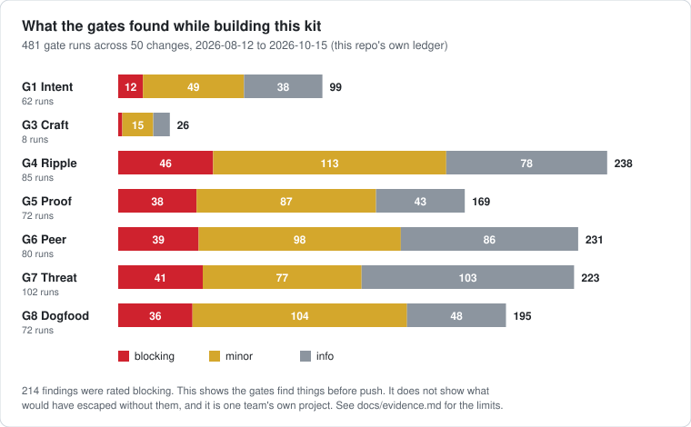

# Evidence so far

What the kit's own ledger shows, and, as important, what it cannot show. Every number here
comes from `ledger.jsonl` in this repository, read with `bash tools/ledger.sh report`, as of
**2026-10-15**. Re-run the report before quoting any of them. They are self-reported by one
author on one project.



## What the ledger records

| Measure | Value | Read it as |
|---|---|---|
| Gate runs | 481 across 50 changes, 2026-08-12 to 2026-10-15 | Sustained use on a real codebase: this kit's own |
| Of those, fresh-context runs | 381 | The reviewer got the diff, not the author's explanation |
| Findings recorded | 1,181, of which 214 rated blocking | Gates do find things before push |
| Runs that failed | 181 of 481 (38%) | A fail is a result, not an error: it is what sends a change back |
| Challenge rate | 30% | Share of fresh runs that contradicted the author. Near 0% would mean a gate only confirms |
| Routes recorded | 90; the real diff gave a different tier than planned in 10, and 9 of those were under-classified | Why the tier is re-derived from the diff instead of trusted from the plan |
| Tokens spent | about 15.8M (a floor: 311 runs recorded none) | A budget figure, not an outcome |

### Per gate

| Gate | Runs | Findings | Findings per fresh run | Contradicted the author | Avg tokens per run |
|---|---:|---:|---:|---:|---:|
| G1 Intent | 62 | 99 | 2.30 | 0% | 12k |
| G3 Craft | 8 | 26 | 4.33 | 17% | 119k |
| G4 Ripple | 85 | 238 | 3.31 | 39% | 109k |
| G5 Proof | 72 | 169 | 3.13 | 7% | 68k |
| G6 Peer | 80 | 231 | 3.00 | 42% | 109k |
| G7 Threat | 102 | 223 | 3.10 | 49% | 101k |
| G8 Dogfood | 72 | 195 | 3.42 | 28% | 95k |

The cost column is why the kit reports tokens per gate: it tells you which review is
expensive, so you can put a cheaper model on it or retire a gate that has stopped finding
anything.

## Use beyond this repository

Nine projects have been built with the pipeline: eight private ones and one public one,
[Focus Guard — Website Blocker](https://chromewebstore.google.com/detail/focus-guard-%E2%80%94-website-blo/blbbadphbklfpllimmcnhjcacdicmnge), a Chrome extension on the Chrome Web Store.
The public listing is evidence that the kit was used to ship a real product. The private
projects' ledgers are not published, so none of the numbers on this page come from them. Treat
the nine projects as proof of use and the ledger figures above as proof of what the gates
recorded, and neither as proof that defects went down.

## What it does not show

- **It does not show fewer defects.** No escape has ever been recorded, but "no escapes"
  here means no one went looking, not that none happened. There is no control group.
- **It does not show less effort.** Only 15 of 481 runs recorded `--minutes`, so there is no
  time data. The token figure is cost, not the author's effort.
- **It does not show routing beats reviewing everything.** It shows routing found 9 changes
  that were bigger than planned. It never ran the alternative.
- **Gate overrides happened.** The threat gate was skipped 20 times out of 102 runs, several
  of them while the gate itself was being built. That is published here on purpose.
- **The sample is one project, built by the people who built the kit.** The paired
  experiments in `experiments/` are four unblinded pairs on one codebase.

## How to find out for your own project

This is why the kit ships its own measurement. After a few weeks on your project:

```bash
bash .pipeline/tools/ledger.sh report      # the table above, for your ledger
bash .pipeline/tools/status.sh             # is it on, and what is unrouted
```

`tools/benchmark/` runs the same change with the routed gates and with all gates, into
separate ledgers, so cost and findings can be compared on your own work. If it shows the
routed pipeline costs more than it saves, that is the result.
